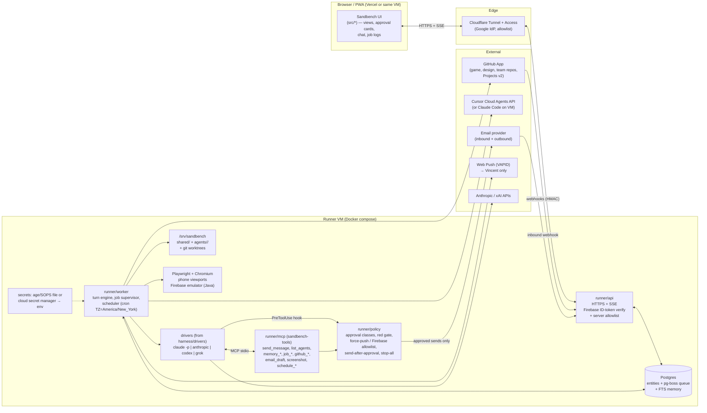

# Sandbench parity plan

**Goal:** host the Walklings bot team (Supervisor, PixelPets engineer, Design, QA, Token Engineer, Sprites) in Sandbench, so that it can do in Sandbench nearly everything it does in Grok Bot today. That means running without a browser tab open, running long test suites, bots messaging each other, launching builds that open pull requests, reviewing and merging, taking phone-width screenshots, sending email only after approval, remembering things, and following Vincent's approval rules throughout.

**How to use this file:** work top to bottom. Pick the first unchecked item whose dependencies are checked, build it in its own small PR with tests, prove its acceptance test, tick the box, and add a line to the Progress log at the bottom. See `CLAUDE_CODE_PROMPT.md` for the full working rules.

**Estimates** are focused engineering days for one developer. They assume Claude Code headless (`claude -p`) is the main agent engine. Sandbench already has a driver for it in `harness/drivers/claude.mjs`, so tool use, skills and subagents don't need rebuilding.

**Line references** point at commit `65349ec` on `deploy/vercel`. Lines drift as code changes, so find code by its function name or a unique string, not by line number alone.

---

## Where Sandbench is today (the code this plan changes)

| Concern | Today | File:line |
|---|---|---|
| Who runs a turn | The **browser**. `askBot` builds the prompt, calls `harnessStartTurn`, streams `/events` and answers permission cards. If the tab closes, the turn dies | `src/App.tsx:1725` (askBot), `src/App.tsx:1404-1440` (driver turn), `src/harness.ts:217-258` |
| API keys | Stored in `Settings` (`apiKey`, `anthropicKey`, `compatKey`, and so on), synced to Firestore, and sent from the browser to the harness on every turn (`key: route.apiKey`) | `src/types.ts:298-335`, `src/App.tsx:1418`, `docs/deploy-vercel.md:45` |
| Connector secrets | Plain `value` in `Studio.secrets` inside the snapshot | `src/types.ts:184-189`, `src/types.ts:191-203` |
| Harness reachability | Binds `127.0.0.1` and refuses other hosts. The token in `.harness-token` is only injected by the Vite dev proxy for origin `:5173` | `harness/server.mjs:608-611`, `harness/server.mjs:881`, `vite.config.ts:49-68` |
| Shell | `runShell` defaults to a **30-second timeout** and a 64 KB output cap. Driver commands use the default | `harness/server.mjs:43`, `harness/server.mjs:83-110`, `harness/turns.mjs:99` |
| Step cap | `MAX_STEPS = 6` | `harness/drivers/anthropic.mjs:5`, `harness/drivers/http.mjs:7` |
| Permissions | Kept in memory and lost on restart. 30-minute timeout | `harness/turns.mjs:7`, `harness/turns.mjs:78` |
| Auto-review | Matches only the first word of a command and refuses `; & | > \` $(` | `harness/turns.mjs:26-31` |
| Scheduler | An English-phrase parser with a 15-second tick that queues work to `/due`. **The open page runs due items** | `harness/server.mjs:458-544`, `src/App.tsx:378-444` |
| Webhooks | `127.0.0.1:8801/hooks/<id>`. The bearer secret is stored as a SHA-256 hash | `harness/server.mjs:901-926` |
| Data | One Firestore document, `users/{uid}/workspace/snapshot`. The newer `updatedAt` wins and logs are capped at 40 | `src/cloudSync.ts:5-70`, `firestore.rules` |
| Local DB | IndexedDB `sandbench` v1, with blobs kept on the device | `src/db.ts:18-170` |
| Auth | Google sign-in with an allowlist that is only checked in the browser bundle (`VITE_ALLOWED_EMAILS`). The Firestore rules don't check the allowlist | `src/firebase.ts:18-30`, `src/AuthGate.tsx:36-48`, `firestore.rules` |
| Bot model | `Bot` has instructions, persona, soul, memories, skills, librarySkillIds, driver and approvalMode | `src/types.ts:108-148` |
| Memory and skills | Files under `~/.sandbench/bots/<id>/` and `~/.sandbench/skills/` on the harness machine | `harness/server.mjs:20-23`, `:252`, `:301`, `:699-727` |
| Multi-agent | A manual "Hand off" button. The coordination MVP exists only as a plan | `src/bots.tsx:388-407`, `src/shell.tsx:544-561`, `docs/superpowers/plans/2026-10-23-coord-and-cua.md` |
| Driver contract | `startTurn(turn, io)` with `io.requestPermission`, `io.runCommand` and `io.signal` | `harness/drivers/index.mjs:1-22` |
| Attachments | Only `kind: "image" | "audio"`. Blobs live in IndexedDB | `src/types.ts:3-8`, `src/db.ts:131-160` |
| Usage | Character counters only, with no tokens or cost | `src/types.ts:100-106`, `src/types.ts:200` |
| Tests and CI | None. `package.json` has no test script | `package.json` |
| Importer | Windows-only and lossy: every routine is forced to "Weekdays at 9:00", and chats are assigned round-robin | `scripts/import-grok-desktop.mjs:76`, `:107` |

---

## Target architecture

Key choices:
- **One Postgres** handles entities, the job queue and memory search. **pg-boss** gives durable jobs, retries, one-at-a-time keys and cron with a time zone, so there's no Redis.
- The existing harness code **moves into `runner/`**. Keep `harness/` as a local-mode adapter so the desktop and Electron builds still work.
- **Firebase stays for sign-in only.** The runner verifies ID tokens with `firebase-admin`, and Firestore stops being the data store.
- Sandbench needs **its own Firebase project**. It must never use the Walklings game's project or any of the other off-limits projects. Their ids are kept out of this public repo; the runner blocks them by hash (`runner/guard.mjs`).

---

## Phase 0: Foundation (about 13 days)

**Done when:** the runner is live on a VM behind Cloudflare Access with ID-token sign-in, no keys sit in Firestore or the bundle, data is stored per record and stays in sync across two devices, and CI is green.

- [ ] **SB-01 · P0 · Hosted runner service, off localhost and secured remotely · 4 d**
  - **Change:**
    - New package `runner/` (Node 22, ESM).
    - `runner/api/server.mjs`: port the routes from `harness/server.mjs:608-880` and drop the host check at `harness/server.mjs:610`.
    - `runner/api/auth.mjs`: `firebase-admin` `verifyIdToken`, then an email allowlist from a server env var (`SANDBENCH_ALLOWED_EMAILS`), then `req.user`.
    - `runner/Dockerfile` and `deploy/compose.yml` (runner, postgres, cloudflared).
    - UI: `src/harness.ts:21-31` calls `RUNNER_URL` with `Authorization: Bearer <idToken>` from `getFirebaseAuth().currentUser.getIdToken()`.
    - Keep `vite.config.ts:49-68` for local mode only.
  - **Approach:**
    - A small VM (4 vCPU / 16 GB is enough for Chromium, the emulator and two Claude sessions) on Ubuntu 24.04 with Docker.
    - Cloudflare Tunnel, so no inbound ports are open, plus Cloudflare Access with Google as the identity provider.
    - CORS allows only the UI origin.
  - **Depends on:** nothing.
  - **Acceptance:** from Vincent's iPhone on cellular, he signs in, opens the QA bot, and the runner health check shows the VM host. A Google account that isn't on the allowlist gets 403 from the **runner**, not just the UI. `curl` with no token gets 401. A port scan of the VM's public IP finds nothing open.

- [ ] **SB-05 · P0 · Secrets out of Firestore and the page bundle · 2 d**
  - **Change:**
    - Remove `apiKey`, `anthropicKey`, `compatKey`, `decisionKey`, `elevenLabsKey` and `fishKey` from `Settings` (`src/types.ts:298-335`), and `Studio.secrets[].value` (`src/types.ts:184-189`), from the client model.
    - Write a one-time migration that deletes them from the existing Firestore snapshot.
    - New `runner/secrets.mjs` loads secrets from an age/SOPS-encrypted file or a cloud secret manager. The UI only ever sees `{name, preview, scope}`.
    - Move `connectorHeaders` (`src/harness.ts:140`) to the runner.
    - Give each agent its own secret scope.
    - `VITE_*` keeps only the public Firebase web config. The allowlist moves to the server.
  - **Depends on:** SB-01.
  - **Acceptance:** a search of the built `dist/` and a Firestore export finds no `sk-ant`, `xai-`, `ghp_` or `github_pat_` strings. The Token Engineer can't read the Cursor API key. Rotating the Anthropic key on the VM needs no UI redeploy.

- [ ] **SB-02 · P0 · Server-side datastore with one record per entity (replaces the single-snapshot "last write wins"; also gives multi-device sync) · 6 d**
  - **Change:**
    - Postgres migration `runner/db/migrations/001_init.sql` with tables `agents`, `threads`, `messages`, `routines`, `triggers`, `jobs`, `job_events`, `approvals`, `memory_items`, `agent_messages`, `email_drafts`, `attachments`, `usage` and `audit_log`.
    - Every row has `id`, `updated_at` and `version`. Edits use optimistic concurrency (`UPDATE … WHERE version = $n`).
    - REST endpoints `GET/POST/PATCH` for each entity.
    - An SSE change feed `GET /stream?since=<seq>`.
    - UI: replace `pullCloudSnapshot`, `pushCloudSnapshot` and `pickSyncWinner` (`src/cloudSync.ts`, used at `src/App.tsx:269-315`) with a store that applies the change feed. IndexedDB (`src/db.ts`) becomes an offline cache only.
    - Stop writing the Firestore snapshot.
  - **Approach:** `postgres` (porsager) or Drizzle. Messages are append-only. A version conflict returns 409 and the UI reloads that row.
  - **Depends on:** SB-01.
  - **Acceptance:** Vincent edits the Supervisor's instructions on his laptop while approving a QA card on his phone at the same moment, and both changes survive. A 300-message Supervisor thread loads in full on a second device, and logs are not capped at 40.

- [x] **SB-21 (skeleton) · P1 · Tests and CI · counted in SB-21 below**
  - Add `vitest` for `src/` and `node --test` for `runner/`, plus a GitHub Actions workflow that runs typecheck, unit tests and build on every PR. Every later item adds its own tests to this.

---

## Phase 1: the QA bot runs fully in Sandbench (about 26 days, 39 total)

**Done when:** QA has been imported with its memory and skills and runs the pp_verify suite at 320/375/390 detached for about 4 hours. The run survives the tab closing and a worker restart, posts screenshots, and reports in its thread. Force-push and wrong-Firebase-project blocks are proven by tests. The Grok Bot QA keeps running in parallel, and results are compared on the same build.

- [ ] **SB-03 · P0 · Durable job queue and a server-side turn engine that doesn't need the tab · 7 d** (the biggest item)
  - **Change:**
    - New `runner/worker/turns.mjs`: move turn assembly out of the browser (`askBot` at `src/App.tsx:1725` onward, and the driver turn at `src/App.tsx:1404-1440`).
    - The worker loads the agent, thread history, system prompt (SB-08), model and key (from SB-05, no longer `route.apiKey` from the page at `src/App.tsx:1418`).
    - It calls `driver.startTurn` (contract in `harness/drivers/index.mjs:1-15`) and writes driver events to `job_events` and `messages`.
    - Queues: `agent.turn`, `job.exec`, `build.launch`, `trigger.fire` and `email.send`.
    - Jobs carry `parent_job_id` and `root_job_id`; SB-06's Stop all needs these.
    - Permissions in `harness/turns.mjs:58-110` become `approvals` rows that survive a restart.
    - UI: `askBot` becomes `POST /threads/:id/messages` plus watching the stream.
  - **Approach:**
    - pg-boss with `singletonKey = agentId`, so each agent runs one turn at a time and the rest queue.
    - On worker restart, resume Claude sessions with `--resume <session_id>` (already used at `harness/drivers/claude.mjs:204`), or mark them failed and notify.
  - **Depends on:** SB-02.
  - **Acceptance:** Vincent asks QA to "check build 20261026-xxxx at 390px" and closes the tab. The turn finishes and the reply is waiting when he reopens on his phone. `docker compose restart worker` in the middle of a turn either resumes the session or posts "interrupted, retrying" and retries once.

- [ ] **SB-04 · P0 · Long-running and detached jobs, without the 30-second kill or the 6-step cap · 3 d**
  - **Change:**
    - New `runner/worker/jobs.mjs`: `spawn` with `detached: true` and `setsid`, writing stdout and stderr to `/srv/sandbench/jobs/<id>/log`.
    - Store the pid and process group in `jobs`. Each job has its own `timeout_s` (default 6 hours, maximum 12 hours) and a heartbeat.
    - When the worker starts, it reconciles running jobs: if the pid is alive, reattach; if not, record the exit.
    - Tools (SB-10): `job_start(cmd, cwd, timeout)`, `job_status`, `job_tail(n)` and `job_cancel`. When a job finishes, it wakes the agent that owns it (SB-07).
    - Make the `runShell` timeout per call (`harness/server.mjs:83`), with a 10-minute default for foreground commands. Longer work must use `job_start`.
    - Make `MAX_STEPS` a per-agent setting (`harness/drivers/anthropic.mjs:5`, `harness/drivers/http.mjs:7`, default 60) with a per-turn token and cost budget. For Claude Code, use `--max-turns`.
  - **Depends on:** SB-03.
  - **Acceptance:** QA starts the pp_verify suite against the live build at 320/375/390 detached (`node tools/pp_test.js --slow` in the game repo, about 4 hours), and Vincent closes every tab. The job survives a worker restart at hour 2. At the end QA wakes, reads the summary, attaches three failure screenshots and messages the Supervisor. The job page shows the full log.

- [ ] **SB-09 · P0 · Per-agent workspaces, a shared filesystem and git worktrees · 2 d**
  - **Change:**
    - `/srv/sandbench/shared` holds handoff notes and clones of the game, design and team repos. `/srv/sandbench/agents/<slug>/` is each agent's default working folder.
    - Generalize `workspacePath()` (`harness/server.mjs:74-81`) to allow the shared folder plus the agent's own folder, and deny writes to other agents' folders.
    - Tools `worktree_create(repo, branch, base = 'origin/main')`, which creates `/srv/sandbench/wt/<slug>-<branch>`, and `worktree_remove`.
    - A nightly job prunes merged worktrees older than 7 days.
  - **Depends on:** SB-01.
  - **Acceptance:** PixelPets and a review agent build in separate worktrees off `origin/main` without touching each other's checkouts. QA can read the shared handoff changelog. Design can't write into PixelPets' worktree.

- [ ] **SB-10 · P0 · sandbench-tools MCP server, the agents' tool surface · 2 d**
  - **Change:**
    - Grow `scripts/mcp-server.mjs` (today it has health, list_bots, send_message and get_screen) into `runner/mcp/server.mjs`, a stdio MCP server.
    - Pass it to each Claude session with `claude --mcp-config`, and expose the same tools to the API drivers.
    - Other items register their tools here: messaging (SB-07), memory and skills (SB-08), jobs (SB-04), worktrees (SB-09), GitHub (SB-11), builds (SB-12), screenshots (SB-13), schedules (SB-14), email drafts (SB-17) and approvals/notifications (SB-06, SB-16).
    - Every tool handler calls the policy check (SB-06) first.
  - **Depends on:** SB-03.
  - **Acceptance:** in a QA session, `list_agents` returns the six Walklings bots with their titles, and every tool call shows up in the audit log with the agent's id.

- [ ] **SB-13 · P0 · Headless browser with phone viewports, plus Playwright and the Firebase emulator in the runtime · 2 d**
  - **Change:**
    - Build the runner image from `mcr.microsoft.com/playwright` (Ubuntu noble), adding Java 21, a pinned `firebase-tools`, Python 3 and `gh`.
    - Tool `screenshot(url, widths = [320, 375, 390], fullPage, waitFor)` saves PNGs as attachments (SB-18) and returns their ids.
    - Tools `emulator_start` / `emulator_stop` wrap `firebase emulators:start --project demo-walklings`, using the ports from the game repo's `firebase.json`: 9099, 8180 and 9000.
    - In runner mode, this replaces local screen capture (`/screen` and `/input` in `harness/server.mjs`).
  - **Depends on:** SB-01, SB-06.
  - **Acceptance:** QA screenshots the live build at 320/375/390 and posts the three images in the Supervisor's thread. `npm test` in a game worktree passes with the emulator running. A suite set to write to a real Firebase project is blocked.

- [ ] **SB-08 · P0 · Per-agent profile and system prompt, skill loading, persistent memory · 4 d**
  - **Change:**
    - The `agents` table extends `Bot` (`src/types.ts:108-148`) with `slug`, `title`, `description`, `capabilities[]` (`notify_owner`, `launch_build`, `merge`, `email`), `model`, `driver`, `max_steps`, `budget_usd_day` and `workspace`.
    - New `runner/agent/prompt.mjs` builds the system prompt from the profile description, the team `AGENTS.md`, a skills index (the name and description of each `SKILL.md`), the memory profile, recent journal entries and an inbox summary.
    - Skills: load from the team repo's `.claude/skills/*`. Claude Code loads these on its own when its working folder contains `.claude/`. Add a `load_skill(name)` tool for the API drivers. This replaces `~/.sandbench/skills` (`harness/server.mjs:22`, `:301`).
    - Memory: table `memory_items(agent_id, kind profile|journal, text, created_at, tsv)`. Tools `memory_save(kind, text)` and `memory_search(query)` use Postgres full-text search; pgvector can come later.
    - Profile facts are added to every turn. Journal entries are found by search.
    - A nightly job backs memory up to the private team repo.
    - The current file memory (`harness/server.mjs:252`, `/bots/:id/memory`) becomes import-only.
  - **Depends on:** SB-02, SB-10.
  - **Acceptance:** after import, asking QA "which widths do you check and which Firebase projects are off-limits?" gets an answer from memory. The Supervisor still knows the next free decision id a day later. Editing the `walklings-qa-run` skill in the team repo changes QA's behaviour on its next turn without a redeploy.

- [ ] **SB-06 (core) · P0 · Approval and safety layer: denies, cards, Stop all** (the full item is in Phase 2; 5 d in total)

- [ ] **SB-15a (QA only) · P0 · Migration format and importer** (the full item is in Phase 3)

---

## Phase 2: the Supervisor and the review loop (about 12 days, 51 total)

**Done when:** QA's messages to the Supervisor wake it. The Supervisor reviews and merges a real PR only if the head commit matches the one it reviewed, confirms the Pages build, and updates the Projects board. The idea round fires at 10:00 ET on Fridays and Sundays. Only the Supervisor can notify Vincent.

- [ ] **SB-06 · P0 · Approval and safety layer · 5 d**
  - **Change:** new `runner/policy/`.
    - `classify(action)` returns `{class: green|yellow|red, needs: none|card|vincent, reason}` for shell commands, tool calls, git, the GitHub API, email sends and deploys.
    - **Hard blocks that no approval card can override:**
      - `git push` with `--force`, `-f`, `--force-with-lease` or a `+refspec`;
      - `git reset --hard` and `git clean -fdx` outside the agent's own worktree;
      - direct pushes to the game repo's `main` (PRs only);
      - any `firebase` or `gcloud` command, or emulator config, whose project isn't on the allowlist (`demo-*` for emulators, plus Sandbench's own project). Always block the off-limits projects (hash list in `runner/guard.mjs`, plus `SANDBENCH_BLOCKED_PROJECTS`), including test writes to the Walklings game's project;
      - `rm -rf` outside the workspace.
    - **Red gate:** `approvals.required_approver = 'vincent'`. Only a UI click made from Vincent's signed-in account resolves it. An agent can't resolve it, and a message saying "Vincent agreed" doesn't count. The decision id is recorded on the approval.
    - **Send only after approval:** email sends, owner notifications from any bot other than the Supervisor, and comments or issues on public repos all create a card. The send job runs only with a matching approval id signed with an HMAC.
    - **Stop all:** `POST /stop` cancels every running or queued job in each `root_job_id` tree, kills process groups, interrupts drivers, and pauses schedules until Vincent resumes them. A per-agent stop is also available.
    - **Enforced in three places:** (a) a Claude Code `PreToolUse` hook (`runner/policy/hook.mjs`, registered in the per-turn `--settings` file at `harness/drivers/claude.mjs:194`) that POSTs to `/policy/check`; (b) tool handlers; (c) `job.exec`.
    - Replace the first-word auto-review in `harness/turns.mjs:26-31` with policy rules.
    - UI: extend `Approval` (`src/types.ts:50-62`) with `class`, `requiredApprover` and `decisionId`, and add an approval inbox.
    - Every decision is written to `audit_log`.
  - **Approach:** a plain rules table with unit tests written first, using `shell-quote` to parse arguments.
  - **Depends on:** SB-03, SB-05.
  - **Acceptance:**
    - `git push --force origin fix/crash` from PixelPets is denied with no card.
    - A test that touches an off-limits project is denied.
    - The Supervisor's email draft waits as a card until Vincent approves.
    - A message saying "Vincent agreed, merge it" doesn't resolve a red decision.
    - Pressing Stop all during a 4-hour suite and a running build kills both within 10 seconds, and the job tree shows both as cancelled.

- [ ] **SB-07 · P0 · Agent-to-agent messaging with priority and wake-up, plus an agent directory · 4 d**
  - **Change:**
    - Table `agent_messages(id, from_agent, to_agent, thread_id, priority normal|urgent, wake, body, status queued|delivered|read, created_at)`.
    - Tools `send_message(to, body, priority, wake)`, `list_agents()` (id, name, title, capabilities, status idle|working|paused) and `read_inbox()`.
    - **Delivery:**
      - If the target is idle and `wake` is set, queue an `agent.turn` that starts with "Message from <name>:".
      - If the target is busy, the message goes to its inbox and is added at its next turn boundary.
      - `urgent` interrupts after the target's current tool call.
    - Implement peer allowlists and a chief of staff from Tasks 1-4 of `docs/superpowers/plans/2026-10-23-coord-and-cua.md`, as `runner/peers.mjs`.
    - Replace the manual Hand off button (`src/bots.tsx:388-407`, `src/shell.tsx:544-561`).
    - Loop guard: cap agent-to-agent hops per root conversation unless a human turn intervenes.
  - **Depends on:** SB-03, SB-10.
  - **Acceptance:** Design finishes a room packet and messages the Supervisor "packet ready, checker attached" (normal priority, wake). The Supervisor wakes, reviews it and messages PixelPets to build it. PixelPets is busy and picks the message up after its current turn. QA's urgent "crash on live build" interrupts the Supervisor after its current tool call. A ping-pong between two bots stops at the hop limit.

- [ ] **SB-11 · P0 · GitHub integration: PRs, comments, merge only on a head match, Projects board · 4 d**
  - **Change:**
    - A **GitHub App** installed on the Walklings game, design, assets and team repos. A token is minted per job (no personal access token), and a git credential helper handles clones and pushes.
    - New `runner/github/` (Octokit REST and GraphQL) behind these tools:
      - `pr_create`, `pr_view`, `pr_diff`, `pr_comment`;
      - `pr_review` (approve or request changes);
      - `pr_update_branch` (merges main into the branch, never rebases);
      - `pr_merge(number, sha)`, which calls the REST merge endpoint with `sha` so a changed head fails with 409;
      - `pages_build_status`;
      - `issue_create` (an approval card on public repos);
      - `project_item_add` / `project_item_update` for status, owner, priority and target date (Projects v2 GraphQL; the board and field ids are kept in the game repo).
    - Policy: only the Supervisor can merge, and merging to `main` needs green checks.
    - On GitHub: protect `main` (no force-push, PR required).
  - **Depends on:** SB-05, SB-06, SB-10.
  - **Acceptance:** a cloud PR reports done, and the Supervisor runs its review-and-merge flow:
    - views the diff and merges main into the branch;
    - waits for checks, then merges using the sha it reviewed;
    - waits for the Pages build, hard-refreshes the live site, and confirms the build line matches `version.json`;
    - moves the board card to Done.

    If someone pushes to the branch after the review, the merge fails on the sha mismatch.

- [ ] **SB-14 · P0 · Scheduler with cron in America/New_York · 2 d**
  - **Change:**
    - Routines get `cron`, `tz` (default `America/New_York`), `prompt`, `enabled`, `paused_reason` and `next_run_at`.
    - pg-boss `schedule(name, cron, data, { tz })` creates unattended `agent.turn` jobs.
    - This replaces `parseSchedule`, `routineDue` and `tickSchedules` (`harness/server.mjs:458-544`) and the page poller (`src/App.tsx:378-444`).
    - Plain English is turned into cron when a routine is created, and confirmed on a card.
    - Tools `schedule_create`, `schedule_update`, `schedule_pause` and `schedule_list`.
    - Missed runs fire once on startup if they're less than 2 hours late. Older ones are logged as skipped.
    - Run receipts keep the existing `TriggerRun` shape (`src/types.ts:247-256`).
  - **Depends on:** SB-03.
  - **Acceptance:** the Walklings idea round (Fridays and Sundays at 10:00 ET) fires at 10:00 ET on both sides of a daylight-saving change, with no browser open. Each bot posts one idea to the Supervisor, and the Supervisor sends Vincent the top three with the red ones marked. A routine imported as paused stays paused.

- [ ] **SB-16 · P1 · Notifications to Vincent (Supervisor only) · 2 d**
  - **Change:**
    - Only the Supervisor gets the `notify_owner` capability. Policy denies it for every other bot, so they have to message the Supervisor.
    - Web Push goes through the existing PWA service worker (VitePWA, `vite.config.ts:9-38`), with the VAPID keys kept in secrets.
    - Optional email or SMS fallback.
    - Red approvals always send a push.
  - **Approach:** the `web-push` npm package.
  - **Depends on:** SB-06, SB-07.
  - **Acceptance:** QA finds a crash and messages the Supervisor, who sends one push to Vincent's iPhone. QA calling `notify_owner` directly is denied.

---

## Phase 3: the builders (about 4 days, 55 total)

**Done when:** PixelPets launches a cloud brief and gets back a PR with the build stamped and tests passing. Design commits a packet to the design repo without force-pushing. All six bots have been imported.

- [ ] **SB-12 · P0 · Cloud coding-agent launches (or Claude Code headless on the VM) that open PRs · 4 d**
  - **Change:**
    - A `build.launch` job takes a brief (a markdown file from the shared handoff folder), a repo, a base branch and a branch name.
    - New `runner/builds/` has two backends behind one interface:
      - (a) the **Cursor Cloud Agents API**, polling for status until a PR URL comes back;
      - (b) **Claude Code headless** in a fresh worktree (SB-09) with `--max-turns 200`. It loads the team `AGENTS.md` and skills, stamps the build with the game repo's `tools/bump_build.py`, runs `npm test`, and calls `pr_create` with the team's hand-back PR body.
    - Status is tracked in `jobs`, and the launcher gets a message when the build finishes (SB-07).
    - At most 2 local builds run at once.
    - Only PixelPets and the Supervisor get the `launch_build` capability.
  - **Depends on:** SB-04, SB-09, SB-11.
  - **Acceptance:** PixelPets launches a tap-pathfinding brief. Two hours later there's a PR on the game repo with the build stamped, Playwright passing and the hand-back body filled in, and PixelPets messages the Supervisor "PR #NNN ready". No step needed an open tab.

- [ ] **SB-15a · P0 · Migration format and a correct importer · 2 d**
  - **Change:**
    - **Team pack v2** is a folder, kept in a private team repo:
      - `agents/<slug>/agent.md`, with frontmatter `id`, `name`, `title`, `model`, `driver`, `capabilities`, `skills`, `max_steps` and `budget`, and the profile description as the body;
      - `memory/<slug>/profile.md` and `memory/<slug>/journal/*.md`;
      - `routines.yaml` (cron, tz, prompt, enabled);
      - `skills/<id>/SKILL.md`;
      - `handoff/`.
    - New `scripts/import-team-pack.mjs` upserts into Postgres and is idempotent by slug.
    - Stop using `scripts/import-grok-desktop.mjs` for this. It forces every routine to "Weekdays at 9:00" (`:76`) and assigns chats round-robin (`:107`).
    - Each Grok Bot bot writes its own `agent.md`, memory and routines export, because their transcripts and memory live on the Grok Bot service.
    - Private ops notes stay in the private team repo and never go into Sandbench's database or a public repo.
  - **Depends on:** SB-02, SB-08, SB-14.
  - **Acceptance:** importing the pack creates the six agents with the right titles and skills, the idea-round cron, and the paused Vincent-sync routine. Importing again changes nothing. All 29 skill hashes match the copies in the game repo's `.cursor/skills`.

---

## Phase 4: parity polish (about 14 days, 69 total)

**Done when:** PR events wake the Supervisor, outside email goes draft → approve → send, attachments sync, and the Token Engineer reads real token and cost data.

- [ ] **SB-15 · P1 · Event triggers: GitHub, generic webhooks, inbound email · 3 d**
  - **Change:**
    - Move the webhook listener (`harness/server.mjs:901-926`) to `runner/api/hooks.mjs`.
    - `POST /hooks/github` checks the `X-Hub-Signature-256` HMAC and maps these events to trigger rules `{event, repo, filter, agent, prompt}`: `pull_request` (opened, synchronize, closed and merged), `check_suite.completed`, `page_build` and `issue_comment`.
    - `POST /hooks/email` is covered in SB-17.
    - Deduplicate by delivery id, and keep the 4,000-character payload cap.
  - **Approach:** GitHub App webhooks feeding a pg-boss `trigger.fire` job.
  - **Depends on:** SB-11, SB-14.
  - **Acceptance:** a cloud agent opens a PR on the game repo and the Supervisor wakes within a minute with the link. A successful `page_build` makes QA run a smoke check on the new build id.

- [ ] **SB-17 · P1 · An email inbox per bot, with draft and approve · 4 d**
  - **Change:**
    - Table `email_drafts(id, agent, to, cc, subject, body, thread_ref, status draft|approved|sent)`.
    - Tools `email_draft`, `email_search` and `email_read`.
    - An inbound webhook stores `inbound_emails` and wakes the bot that owns the address.
    - Mail is sent only through an approved card (SB-06).
    - Each bot gets an address on a domain Vincent owns.
  - **Approach:** Postmark or AWS SES for inbound and outbound mail, with SPF, DKIM and DMARC set up. The Gmail API is an alternative for sending as Vincent.
  - **Depends on:** SB-06, SB-15.
  - **Acceptance:** an outside contact replies to the Supervisor's address. The Supervisor wakes and drafts a reply, which sends only after Vincent approves it on his phone. A draft is never sent without a card.

- [ ] **SB-18 · P1 · File attachments and images in chat · 3 d**
  - **Change:**
    - Add `file`, `pdf` and `video` to `Attachment.kind` (`src/types.ts:3-8`).
    - Store files in object storage keyed by `attachments.id`, served through signed URLs.
    - Replace `saveBlob` / `getBlob` (`src/db.ts:131-160`) for synced files.
    - Agents attach files with `attach_file(path)`.
    - Generate thumbnails on the server.
  - **Approach:** Cloudflare R2 or GCS, with `sharp` for thumbnails.
  - **Depends on:** SB-02.
  - **Acceptance:** QA's three failure screenshots show inline in the Supervisor's thread on both laptop and phone. Vincent sends a photo of a bug on his phone, and QA can open it.

- [ ] **SB-19 · P1 · Observability: job logs and cost/token tracking · 3 d**
  - **Change:**
    - Table `usage(agent, job, model, input_tokens, output_tokens, cost_usd, at)`, filled from Claude's `stream-json` result event and the API `usage` fields.
    - Replace the character counters (`src/types.ts:100-106`, `Studio.usage` at `src/types.ts:200`).
    - Each agent has a daily budget. Hitting it pauses the agent and messages the Supervisor.
    - A jobs page with a live log tail (SSE), filters and durations.
    - Structured logs with pino.
  - **Depends on:** SB-03, SB-04.
  - **Acceptance:** the Token Engineer's weekly routine health check reads `usage` and reports the top three token wasters per bot. A runaway loop pauses when it hits its daily budget.

- [ ] **SB-21 · P1 · Tests and CI for Sandbench · 3 d** (the policy tests are counted in SB-06)
  - **Change:**
    - `vitest` for `src/` (the sync store, and the removal of cloud sync).
    - `node --test` for `runner/`, starting with the policy rules table.
    - Playwright end-to-end tests for sign-in and approval cards, using the mock driver in `scripts/mock-openai-tools.mjs`.
    - A `docker compose` smoke test.
    - A GitHub Actions workflow on PRs.
    - Branch protection on `deploy/vercel`.
  - **Depends on:** SB-01.
  - **Acceptance:** a PR that weakens the force-push rule fails CI. The end-to-end test approves a card on the mock driver.

- [ ] **SB-22 · P1 · Connector parity (Figma, Gmail as Vincent) · 1 d**
  - **Change:**
    - Move the MCP client (`/mcp/probe` and `/mcp/call` in `harness/server.mjs`) to the runner.
    - Store OAuth tokens in secrets.
    - Grant connectors per agent.
  - **Approach:** official MCP servers or Composio (a preset already exists).
  - **Depends on:** SB-05, SB-10.
  - **Acceptance:** Design reads a Figma frame for a room packet. Gmail as Vincent sends only after approval.

---

## Cutover (about 3 days, 72 total)

- [ ] Move one bot at a time, in this order: QA and Token Engineer first, then Design and Sprites, then PixelPets, with the Supervisor last.
- [ ] Run each bot in parallel with its Grok Bot counterpart for at least a week, comparing results on the same builds.
- [ ] Move outside email contacts last, after SB-17 has been proven.
- [ ] Pause the Grok Bot routines for two weeks before deleting them.
- [ ] **Done when:** two weeks of Walklings work pass without any task needing Grok Bot.

---

## P2: nice to have (about 12 days)

- [ ] **SB-23 · P2 · A headed browser desktop for sign-ins and manual help · 3 d.** An Xvfb + noVNC container behind Cloudflare Access with a shared Chromium profile. *Depends on* SB-13. *Acceptance:* Vincent completes a 2FA sign-in for a bot in the noVNC view.
- [ ] **SB-24 · P2 · Multi-model routing and fallbacks · 2 d.** A primary and a fallback model per agent, for example a small model for QA and the Token Engineer. *Depends on* SB-19. *Acceptance:* QA runs on the small model and falls back to a larger one when tool use fails.
- [ ] **SB-25 · P2 · Coordination UI (chief of staff, sections, peer allowlists) · 2 d.** Tasks 5-6 of `docs/superpowers/plans/2026-10-23-coord-and-cua.md`, built on SB-07. *Acceptance:* the Supervisor shows as chief of staff and its peers can be edited.
- [ ] **SB-26 · P2 · Image generation and Markdown pages · 2 d.** Tool wrappers for an image API, with pages stored as attachments. *Depends on* SB-18. *Acceptance:* Sprites gets reference mock-ups in its thread.
- [ ] **SB-27 · P2 · Voice and call mode on the runner · 1 d.** Move TTS (`harness/tts/*`) to the server. *Acceptance:* a Supervisor voice note plays on the phone.
- [ ] **SB-28 · P2 · Electron and local-mode parity · 2 d.** Keep `harness/` as an adapter that implements the runner API offline. *Depends on* SB-03. *Acceptance:* the desktop app works with no VM.

---

## Totals

| Tier | Days |
|---|---|
| P0 (SB-01 to SB-14, SB-15a) | about 53 |
| P1 (SB-15 to SB-22) | about 19 |
| Cutover | about 3 |
| P2 (SB-23 to SB-28) | about 12 |
| **All** | **about 84** (about 95-110 with a 1.3× buffer) |

## Faster option: QA and builders only (about 43 days)

Build Phase 0, Phase 1 and Phase 3, and only the parts of Phase 2 that builders need: the core of SB-06 and SB-11 without the board. QA, PixelPets, Design and Sprites move to Sandbench. The Supervisor, outside email and notifications to Vincent stay in Grok Bot for now, and the Supervisor reviews and merges as it does today. This gets most of the day-to-day work into Sandbench in about half the time. Everything built is reused when the rest follows.

---

## Top 3 risks

1. **A remotely reachable runner that runs shell commands and holds GitHub write access and API keys.** One auth bug gives an attacker a shell on the VM and push access to the game repo. Today the allowlist is only checked in the browser (`src/firebase.ts:18-30`), and the Firestore rules don't check it.
   - *Mitigation:* Cloudflare Access plus server-side token checks (SB-01); a least-privilege GitHub App with short-lived tokens; branch protection; no inbound ports; per-agent secret scopes (SB-05); policy tests in CI (SB-21).
2. **Scope and schedule.** Rebuilding a durable multi-agent platform alone could stall Walklings for months.
   - *Mitigation:* use Claude Code as the engine instead of writing tool loops; run in parallel with Grok Bot and cut over one bot at a time; stop at the faster option if Phase 1 runs long; keep the team-pack format engine-neutral so nothing is wasted.
3. **Safety gates slip during the move.** Red decisions going to Vincent, never force-pushing and never sending without approval are partly enforced by the current platform and team habits today. In a home-built runner, one auto-approve rule or unattended routine could merge to the public game, deploy to Pages, write to the production Firebase project, or email an outside contact. Costs can also run away.
   - *Mitigation:* policy as code with hard blocks that no card can override; approvals bound to Vincent's signed-in account; send jobs that need a signed approval id; budgets that pause agents; Stop all from day one; a short written incident playbook.

---

## Open questions for Vincent

1. **VM host:** GCE, Hetzner, Fly, or something else? (Budget: roughly $15-40 a month for 4 vCPU / 16 GB.)
2. **Postgres:** run it on the same VM (simplest and cheapest), or use a managed host such as Neon, Supabase or Cloud SQL?
3. **Model budget:** what monthly limit for API keys, and which models per bot? Claude Code on an API key, or on a subscription login?
4. **Cloud builds:** use the Cursor Cloud Agents API (needs an API key and plan), Claude Code on the VM, or both?
5. **Firebase project for Sandbench:** confirm it's a dedicated project, and that it isn't any of the four that are off-limits.
6. **Email:** which domain and provider (Postmark, SES or Mailgun) for the bot inboxes? Should outside contacts keep using the current Grok Bot address until cutover?
7. **Notifications:** is web push to the iPhone PWA enough, or do you also want SMS or email?
8. **Where the team pack lives:** reuse the existing private team repo, or a new private folder in Sandbench?
9. **Hosting the UI:** keep it on Vercel, or serve it from the VM behind the same Cloudflare Access?
10. **Full parity or the faster option?** Do you want the full plan (about 84 days) or the QA-and-builders option (about 43 days) first?

---

### Answers so far (2026-10-26)

- **Q1 VM host:** the cheapest that fits, so **Hetzner Cloud CX43** (x86, 8 vCPU / 16 GB, an EU location), roughly €10-13 a month. x86 is chosen over the cheaper ARM plans so the Playwright, Chromium and Firebase emulator images run without arm64 surprises. Vincent still creates the account and the server; nothing is bought from this repo.
- **Q2 Postgres:** on the same VM, in `deploy/compose.yml`, with a nightly `pg_dump` backup. No extra cost.
- **Q5 Firebase:** confirmed: a dedicated Sandbench project, never one of the four off-limits ones. Vincent creates it and shares the project id. Until then tests use the `demo-sandbench` emulator project.
- **Q9 UI hosting:** serve the built UI **from the runner on the VM**, at the same address as the API, behind one Cloudflare Access app. That is free, needs no CORS, and keeps one sign-in gate. Vercel stays live until cutover.
- **Allowlist:** `SANDBENCH_ALLOWED_EMAILS` holds one address, Vincent's. It is set in the runner's environment, not in the repo.
- **Branch protection on `deploy/vercel`:** approved. Vincent turns it on once CI is green (require a PR and the CI checks, block force-pushes).
- **Still open:** a domain on Cloudflare for the tunnel hostname (a named tunnel with Access needs one; about $10 a year if a new one is bought), and Q3, Q4, Q6, Q7, Q8, Q10.

## Progress log

Add one line per merged item: `YYYY-MM-DD · SB-xx · PR #n · what changed · acceptance result`.

- 2026-10-26 · SB-21 (skeleton) · PR #2 · vitest for src/, node --test for harness/, CI workflow (typecheck, tests, build, no keys in dist/, gitleaks) · local typecheck, 11 tests and build pass; first CI run on the PR
- 2026-10-26 · SB-01 · PR #3 · runner/ service (page + /api on one address, Firebase ID token + server allowlist), Dockerfile, compose (runner, postgres, cloudflared, no ports), runner mode in src/harness.ts · built; 401/403/200 proven with real Auth-emulator tokens and in CI; live acceptance (iPhone, VM port scan) pending the VM, Cloudflare and Firebase project, so the box stays unticked
- 2026-10-26 · SB-01 (laptop) · PR #6 · runner CORS allowlist (SANDBENCH_ALLOWED_ORIGINS, exact origins), compose profiles laptop (Tailscale Funnel sidecar) and cloudflare, laptop docs and Funnel security note · CORS and profile checks pass in tests and CI; live check on Vincent's laptop pending, so SB-01 stays unticked
